  

 

  
  
  

 

  

 

 
Trabzon Üniversitesi'nde **Dijital Oyun Tasarımı** okuyorum ve **Trabzon Üniversitesi OGP**'de ekip üyesiyim. **Unity** ile geliştirdiğim **SheepFarmVille** oyununu Trabzon BilimFest 2026'da sergiledim; oyun yakında Steam'de. **Unreal Engine 5** ve **C++** ile mekanikler ve oyunlar geliştiriyor, **Blender**'da 80'den fazla 3D model, simülasyon ve shader çalışması hazırladım. Hedefim oyun geliştirme alanında kariyer yapmak ve yaratıcı projelere katkı sağlamak.
 

 

  

 

 

  

 

 

  

 

  
  
  
  
  
  
  
  
  

 

 

  

 

 

  
  &nbsp;&nbsp;&nbsp;&nbsp;
  

  
  
  
  
  

  
  

 

 

  

 

  

 

  

 
