<!-- 🎮 BAŞLIK EKRANI (assets/banner.svg, rpg.yml tarafından üretilir) -->

  

  

  
  
  

---

## 🎮 Karakter Ekranı

  

> Trabzon Üniversitesi'nde **Dijital Oyun Tasarımı** okuyorum. Unity ve Unreal Engine ile oyun geliştiriyor, Blender'da 3D model ve sahneler hazırlıyorum. Kendimi **patika.dev** ve **BTK Akademi** ile de geliştiriyorum.

---

## 📜 Görev Günlüğü

| Tarih | Görev | Durum |
|:--|:--|:--:|
| Kasım 2022 | GitHub'a katıldım, Kodluyoruz ile ilk repomu açtım | ✅ |
| Şubat – Nisan 2023 | HTML, CSS, Bootstrap ve JavaScript projeleri | ✅ |
| Nisan 2023 | Patika.dev **Frontend Web Development** patikasını bitirdim | 🏆 |
| Temmuz 2023 | Unity ile **Güneş Sistemi** ve **Tank Oyunu**, C# algoritmalar | ✅ |
| Ağustos 2023 – Aralık 2024 | Blender serisi: **8 repo, 40+ 3D model** | ✅ |
| Ekim – Aralık 2023 | **4 C++ sertifikası** (Sololearn, Programming Hub) | 🏆 |
| Şimdi | Trabzon Üniversitesi · **Dijital Oyun Tasarımı** | ⏳ Devam ediyor |

---

## 🏆 Açılan Başarımlar

| | Başarım | Veren | Tarih |
|:--:|:--|:--|:--|
| 🔓 | Başlangıç Seviye Frontend Web Development Patikası | Patika.dev | Nisan 2023 |
| 🔓 | Introduction to C++ | Sololearn | Ekim 2023 |
| 🔓 | C++ Intermediate | Sololearn | Kasım 2023 |
| 🔓 | C++ | Programming Hub | Aralık 2023 |
| 🔓 | C++ Advanced | Programming Hub | Aralık 2023 |

---

## 🧊 3D Atölye — Blender

| Kategori | Modeller | Repo |
|:--|:--|:--|
| 🏠 Mimari | Lüks villa, yazlık evler, orman evleri, motel, restoran, deniz feneri, korsan evi | [Blender-1](https://github.com/vehbi-cet/Blender-1) · [Blender-6](https://github.com/vehbi-cet/Blender-6) |
| 🚜 Araçlar | Tekne, gemi, traktör, karavan | [Blender-1](https://github.com/vehbi-cet/Blender-1) · [Blender-6](https://github.com/vehbi-cet/Blender-6) |
| ✈️ Havacılık & Askeri | Havalimanı, pist, hangar, askeri üs, savaş uçağı, askeri araç | [Blender-3](https://github.com/vehbi-cet/Blender-3) |
| 🚀 Bilim Kurgu | X-Wing, uzay hangarı | [Blender-3](https://github.com/vehbi-cet/Blender-3) |
| 🪑 Objeler | Piyano, bar taburesi, hot dog standı, güneş paneli, oksijen tüpü | [Blender-3](https://github.com/vehbi-cet/Blender-3) |

  
  
  
  
  
  
  
  

---

## 🕹️ Unity Projeleri

| Proje | Açıklama | Repo |
|:--|:--|:--|
| 🪐 Solar System Project | Unity ile Güneş Sistemi | [Unity-Projects](https://github.com/vehbi-cet/Unity-Projects) |
| 🛡️ Tank Game | Unity ile tank oyunu | [Unity-Projects](https://github.com/vehbi-cet/Unity-Projects) |

---

## 🎒 Envanter

<b>⚔️ Oyun Motorları & 3D</b>

   
  

<b>🔮 Diller</b>

  

<b>🗣️ Konuşulan Diller</b> 
🇬🇧 İngilizce — sınırlı çalışma yetkinliği &nbsp;·&nbsp; 🇩🇪 Almanca — başlangıç

---

## 🐍 Mini Oyun: Katkı Yılanı

  <picture>
    <source media="(prefers-color-scheme: dark)" srcset="https://raw.githubusercontent.com/vehbi-cet/vehbi-cet/output/github-snake-dark.svg" />
    <source media="(prefers-color-scheme: light)" srcset="https://raw.githubusercontent.com/vehbi-cet/vehbi-cet/output/github-snake.svg" />
    
  </picture>

  

